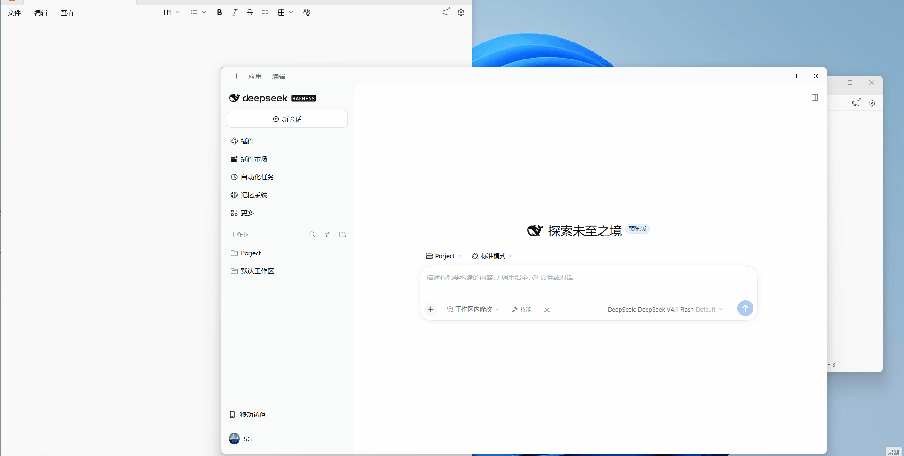
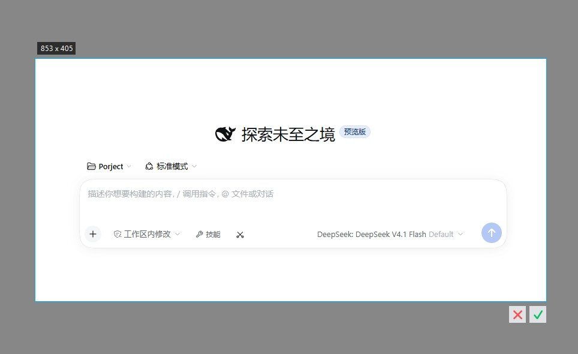
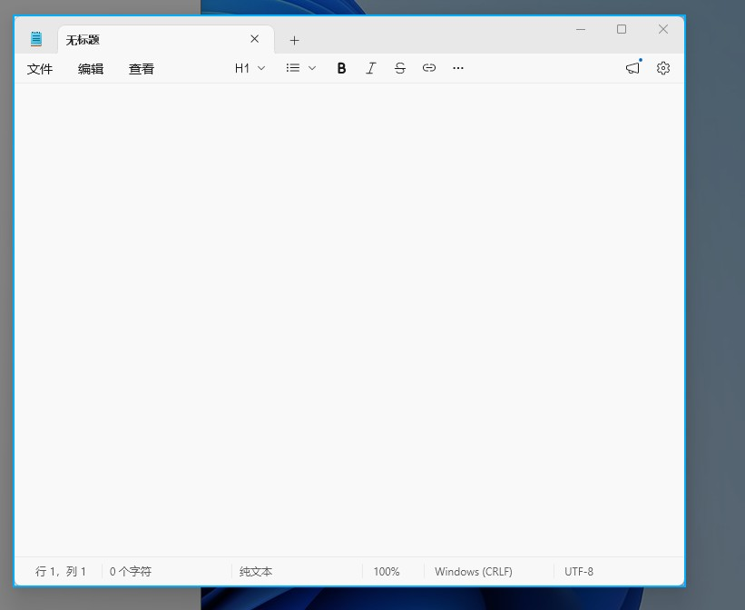

# DSH Screenshot Button

English | [中文](README.md)

Screenshot plugin for the DeepSeek Harness desktop client: a scissors button in the composer toolbar opens a native full-screen crop overlay; the confirmed crop attaches to the composer's attachment rail. Installed as a dsh bundle, no DSH source changes.



| Selection & confirm buttons | Window detection highlight |
|---|---|
|  |  |

## Usage

- **Click the scissors button**: a full-screen overlay opens (an independent always-on-top window covering the whole screen). Drag a selection; confirm/cancel buttons appear at its bottom-right corner (double-click or Enter confirms, Esc or right-click cancels). The crop attaches to the composer automatically.
- **Shift+click the scissors button**: the DSH window is hidden first, so the overlay's background never contains it; the window stays hidden through the whole selection and is restored afterwards.
- Moving the mouse inside the overlay highlights the window under the cursor; a click selects that whole window rectangle.
- Dragging inside a finished selection moves it; dragging its border (±10 px) resizes it, with direction-aware cursors.

## Install

```sh
dsh plugin --profile web add dsh-screenshot-button
```

Or search "screenshot" in the dshmarket plugin market.

Requirements: Windows 10+, PowerShell 7 (pwsh on PATH), DSH desktop ≥ 0.2.1.

Install from source:

```sh
git clone https://github.com/shegan1/dsh-screenshot-button
dsh plugin --profile web add ./dsh-screenshot-button
```

## Configuration

Set in the `config` section of the plugin's insert entry in the profile's cordis.patch.yml; every key is optional:

| Key | Default | Description |
|---|---|---|
| `windowMatchTitle` | `DeepSeek` | Title validation needle for hide mode (the window is located by process chain; the title only validates the final pick and scopes the fallback) |
| `hideDelayMs` | `400` | Maximum wait for the hidden window to leave the screen (120–5000 ms; continues early once it is gone) |
| `maxBase64Bytes` | `16777216` | Screenshot data size cap |

## Implementation notes

Two halves:

- **client.js** (browser side): registers the toolbar button and the full-screen overlay UI; on confirm the crop is dispatched to the composer as a synthetic paste event and flows through DSH's official paste intake into the attachment rail.
- **index.js** (host side): starts one resident PowerShell process (`crop-server.ps1`) that hides the window, captures the screen, shows the overlay (a WinForms form compiled from `crop-form.cs`) and crops, all in that single process; each shot is a stdin command returning one JSON result. Hide mode locates the app window by walking the ancestor process chain from the plugin's host pid — never by title substring alone. Before each capture the Per-Monitor-V2 DPI awareness context is re-asserted and the screen size comes from `GetSystemMetrics`, so Windows scale-factor changes apply without a restart. The C# form's compiler reference set is scanned from the PowerShell install directory, working across .NET 9/10 hosts; without PowerShell 7 a capture fails with a clear error and the host stays unaffected.

Diagnostics are appended to `%TEMP%\dsh-screenshot-debug.jsonl` (event metadata only, no screenshot content).

## Known limitations

- Windows only (capture and overlay rely on WinForms/GDI).
- Hide mode needs to locate the DSH main window along the process chain; a failure reports the reason and plain capture is unaffected.
