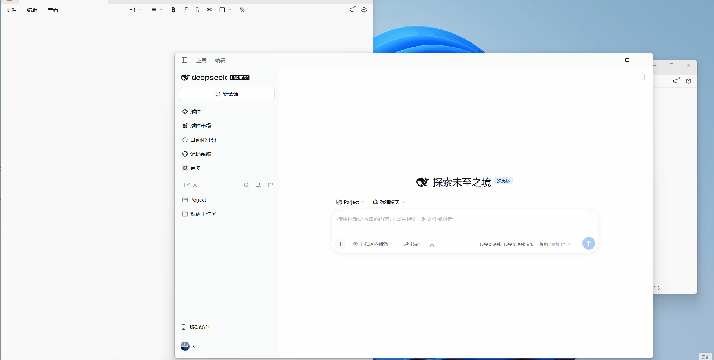
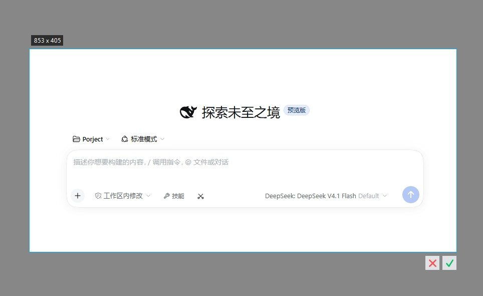
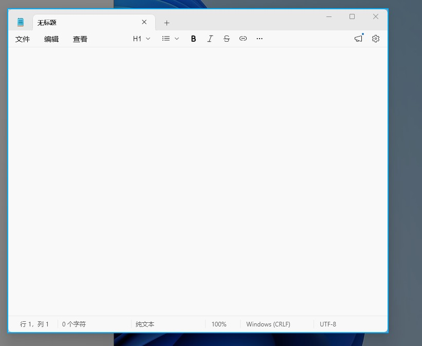

# DSH Screenshot Button

[English](README.en.md) | 中文

DeepSeek Harness 桌面客户端的截图插件：输入框工具行剪刀按钮唤起原生全屏裁剪遮罩，选区确认后裁剪图进入输入框附件栏。以 dsh bundle 形式安装，不修改 DSH 源码。



| 选区与确认按钮 | 窗口识别高亮 |
|---|---|
|  |  |

## 使用

- **点击剪刀按钮**：弹出全屏遮罩（独立置顶窗口，覆盖整个屏幕），拖拽选区后松开，选区右下角出现确认/取消按钮（双击选区或 Enter 也可确认，Esc 或右键取消），确认后裁剪图自动进入输入框；
- **Shift+点击剪刀按钮**：先隐藏 DSH 窗口，遮罩出现后画面中不包含 DSH，整个选区过程窗口保持隐藏，确认后窗口恢复；
- 遮罩内移动鼠标：所在窗口整块提亮显示边界，单击直接选中该窗口区域；
- 选区内按住拖动：移动整个选区；选区边缘（内外约 10px）按住拖动：调整选区大小，光标随方向变化。

## 安装

```sh
dsh plugin --profile web add dsh-screenshot-button
```

或在 dshmarket 插件市场搜索 screenshot。

要求：Windows 10 及以上（系统自带 Windows PowerShell 即可运行，检测到 PowerShell 7 时优先使用）、DSH 桌面版 ≥ 0.2.1。

从源码安装：

```sh
git clone https://github.com/shegan1/dsh-screenshot-button
dsh plugin --profile web add ./dsh-screenshot-button
```

## 配置

配置在安装后的 cordis.patch.yml 中对应 insert 条目的 config 段修改，全部可省略：

| 键 | 默认 | 说明 |
|---|---|---|
| `windowMatchTitle` | `DeepSeek` | 隐藏窗口模式的标题校验子串（窗口定位按进程链进行，标题仅作最终校验与回退过滤） |
| `hideDelayMs` | `400` | 隐藏窗口后等待其从屏幕消失的最长时间（120–5000ms，窗口提前消失则提前继续） |
| `maxBase64Bytes` | `16777216` | 截图数据大小上限 |

## 实现说明

插件分两部分：

- **client.js**（浏览器侧）：注册输入框工具行按钮与全屏遮罩界面；确认选区后把裁剪结果合成 paste 事件派发给输入框，走 DSH 官方粘贴管线进入附件栏；
- **index.js**（宿主侧）：启动一个常驻 PowerShell 进程（`crop-server.ps1`），隐藏窗口、抓屏、显示遮罩（`crop-form.cs` 编译加载的 WinForms 窗体）、裁剪在同一个进程内完成；每次截图通过 stdin 命令下发，结果以 JSON 返回。隐藏窗口按进程祖先链定位（从插件宿主进程上溯到应用主进程），不依赖标题匹配；抓屏前重新声明 Per-Monitor-V2 DPI 感知上下文，屏幕尺寸取自 `GetSystemMetrics`，Windows 缩放比例变更后无需重启即可正确工作。C# 窗体的编译引用集来自 PowerShell 安装目录扫描，兼容 .NET 9/10；未安装 PowerShell 7 时截图会得到明确错误提示，宿主不受影响。

诊断信息写入 `%TEMP%\dsh-screenshot-debug.jsonl`（仅事件元数据，不含截图内容）。

## 已知限制

- 仅支持 Windows（抓屏与遮罩依赖 WinForms/GDI）；
- 隐藏窗口模式需要能沿进程链定位到 DSH 主窗口；定位失败时报错说明原因，普通截图不受影响。
